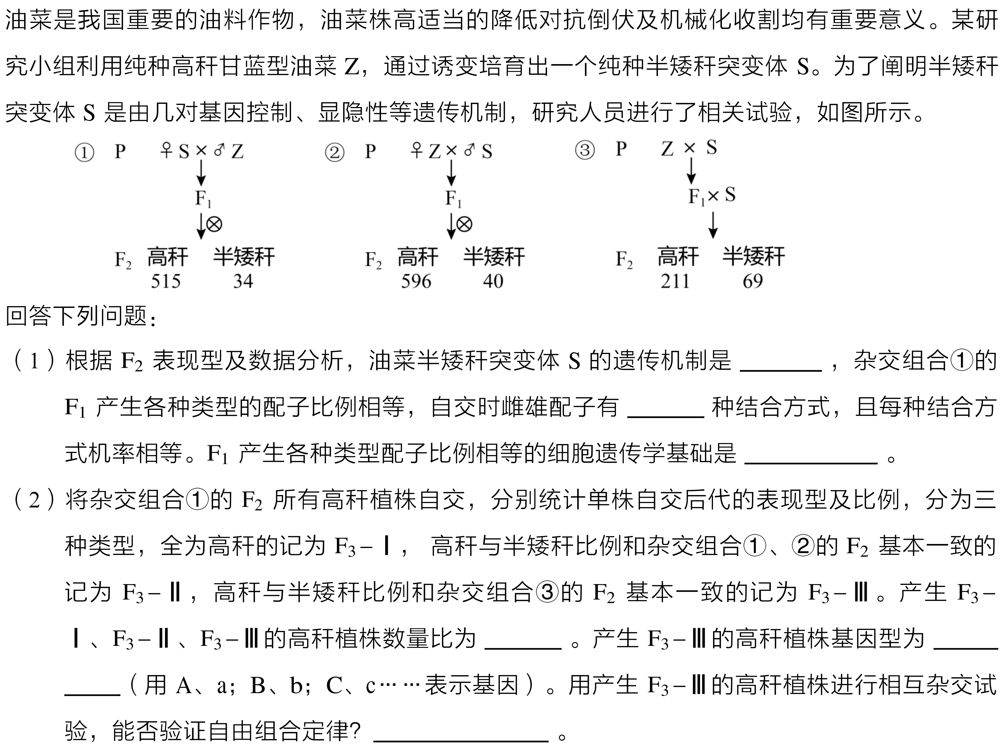

# 2021年湖南卷生物17题遗传学精析

题目描述：

参考答案：

**（1）**

- **半矮秆性状由位于两对常染色体上的隐性纯合基因控制遗传**（或：由两对独立遗传的隐性纯合基因控制）
- **16**
- **F₁通过减数分裂产生配子的过程中，等位基因会随着同源染色体的分开而分离、位于非同源染色体上的非等位基因会随着非同源染色体的自由组合而组合，从而产生比例相等的各种类型配子**（或：在减数分裂Ⅰ后期，同源染色体分离的同时，非同源染色体发生自由组合）

**（2）**

- **7∶4∶4**
- **Aabb、aaBb**（或 **aaBb、Aabb**）
- **否**（或**不能**）

### 一、 题干信息与遗传模型深度剖析

#### 1. 纯种与诱变背景

野生型油菜纯种高秆品系记为 **Z**，经诱变育种获得纯种半矮秆突变体 **S**。研究目的在于确定该性状受几对等位基因控制、显隐性关系以及基因在染色体上的分布情况。

#### 2. 杂交组合数据还原与规律挖掘

- **组合①与组合②（正交与反交）：**
    - 组合①：♀S × ♂Z $\rightarrow$ $\text{F}_1$ $\otimes \rightarrow \text{F}_2$ 高秆 515 株、半矮秆 34 株（$515 : 34 \approx 15.15 : 1$）。
    - 组合②：♀Z × ♂S $\rightarrow$ $\text{F}_1$ $\otimes \rightarrow \text{F}_2$ 高秆 596 株、半矮秆 40 株（$596 : 40 \approx 14.90 : 1$）。
    - **破题点 1（常染色体核遗传）：** 正反交后代表型一致，且男女/雌雄分布无性别偏向，排除细胞质遗传及伴性遗传，基因位于**常染色体**上。
    - **破题点 2（两对独立遗传基因的重叠作用）：** $\text{F}_2$ 性状分离比接近 **$15 : 1$**，这是孟德尔两对等位基因自由组合定律经典比值 **$9 : 3 : 3 : 1$ 的典型变式**（$9+3+3=15$，$1=1$）。

- **组合③（测交组合）：**
    - $\text{P}\ \text{Z} \times \text{S} \rightarrow \text{F}_1 \times \text{S} \rightarrow \text{F}_2$ 高秆 211 株、半矮秆 69 株（$211 : 69 \approx 3.06 : 1 \approx 3 : 1$）。
    - 该组合为双杂合子 $\text{F}_1$ 与纯隐性突变体 S 杂交（相当于测交）。两对独立遗传等位基因测交理论比例为 $1 : 1 : 1 : 1$；当其中 3 份表现为显性性状、1 份表现为隐性性状时，恰好对应 **$3 : 1$**。

#### 3. 基因型与表现型对应机制

设控制该性状的两对基因为 $\text{A/a}$ 与 $\text{B/b}$，位于两对非同源染色体上：

- **高秆（只要含有一个显性基因即表现高秆）：** $\text{A\_B\_}$（9 份）、$\text{A\_bb}$（3 份）、$\text{aaB\_}$（3 份），共占 $\frac{15}{16}$。
- **半矮秆（双隐性纯合）：** 只有 $\text{aabb}$ 表现为半矮秆，占 $\frac{1}{16}$。
- **亲本与 $\text{F}_1$ 基因型：**
    - 纯种高秆亲本 $\text{Z} = \text{AABB}$
    - 纯种半矮秆突变体 $\text{S} = \text{aabb}$
    - $\text{F}_1 = \text{AaBb}$（双杂合子，表现为高秆）

### 二、 分步详细展开解析

#### 第（1）问：遗传机制与配子行为

1. **突变体 S 的遗传机制：** 由 $\text{F}_2$ 出现 $15 : 1$ 及测交后代出现 $3 : 1$ 的性状分离比，说明油菜株高受两对等位基因控制，它们分别位于两对同源染色体上独立遗传。突变体 S 只有在两对基因同时处于隐性纯合状态时才呈现半矮秆，因此其遗传机制可规范表述为：**半矮秆性状由位于两对常染色体上的隐性纯合基因控制遗传**。
2. **雌雄配子结合方式种类：** $\text{F}_1$（$\text{AaBb}$）减数分裂产生 4 种雄配子（$\text{AB} : \text{Ab} : \text{aB} : \text{ab} = 1 : 1 : 1 : 1$）和 4 种雌配子（$\text{AB} : \text{Ab} : \text{aB} : \text{ab} = 1 : 1 : 1 : 1$）。雌雄配子随机受精结合，共有 $4 \times 4 =$ **$16$ 种结合方式**。
3. **细胞遗传学基础：** 配子比例相等的根本原因是减数分裂行为：**$\text{F}_1$ 通过减数分裂产生配子的过程中，等位基因会随着同源染色体的分开而分离、位于非同源染色体上的非等位基因会随着非同源染色体的自由组合而组合，从而产生比例相等的各种类型配子**（即减数分裂Ⅰ后期同源染色体分离与非同源染色体自由组合的实质）。

#### 第（2）问：$\text{F}_2$ 高秆自交分群统计与杂交验证

这是本题的计算难点和核心逻辑考查点。

##### 1. $\text{F}_2$ 高秆植株的基因型构成分析

在杂交组合①的 $\text{F}_2$ 群体中，高秆植株共有 15 份，其基因型及其占全部高秆（分母为 15）的相对比例如下：

- $1/15\ \text{AABB}$
- $2/15\ \text{AABb}$
- $2/15\ \text{AaBB}$
- $4/15\ \text{AaBb}$
- $1/15\ \text{AAbb}$
- $2/15\ \text{Aabb}$
- $1/15\ \text{aaBB}$
- $2/15\ \text{aaBb}$

##### 2. 单株自交后代表型的穷举与归类

将所有高秆单株分别自交，后代是否会出现半矮秆（$\text{aabb}$）完全取决于亲本单株的基因型：

- **类型一：全为高秆（记为 $\text{F}_3\text{-Ⅰ}$）** 这类植株自交后代基因型中绝对不可能出现 $\text{aabb}$。
    - $\text{AABB}$ 自交 $\rightarrow$ 后代全为 $\text{AABB}$（高秆）
    - $\text{AABb}$ 自交 $\rightarrow$ 后代为 $3/4\ \text{AAB\_} + 1/4\ \text{AAbb}$（全部含 $\text{A}$，全为高秆）
    - $\text{AaBB}$ 自交 $\rightarrow$ 后代为 $3/4\ \text{A\_BB} + 1/4\ \text{aaBB}$（全部含 $\text{B}$，全为高秆）
    - $\text{AAbb}$ 自交 $\rightarrow$ 后代全为 $\text{AAbb}$（全为高秆）
    - $\text{aaBB}$ 自交 $\rightarrow$ 后代全为 $\text{aaBB}$（全为高秆）
    - **汇总份额：** $1(\text{AABB}) + 2(\text{AABb}) + 2(\text{AaBB}) + 1(\text{AAbb}) + 1(\text{aaBB}) = \mathbf{7\ 份}$（占高秆的 $7/15$）。

- **类型二：高秆与半矮秆比例与组合①、②一致（即 $15 : 1$，记为 $\text{F}_3\text{-Ⅱ}$）** 自交要出现 $15 : 1$ 的双显性重叠分离比，亲本必须为**双杂合子 $\text{AaBb}$**。
    - $\text{AaBb}$ 自交 $\rightarrow$ 高秆（$9\text{A\_B\_} + 3\text{A\_bb} + 3\text{aaB\_}$）∶ 半矮秆（$1\text{aabb}$）$= 15 : 1$。
    - **汇总份额：** $\text{AaBb}$ 共 **$4\ 份$**（占高秆的 $4/15$）。

- **类型三：高秆与半矮秆比例与组合③一致（即 $3 : 1$，记为 $\text{F}_3\text{-Ⅲ}$）** 单株自交后代若出现 $3 : 1$，说明该植株只在一对基因上杂合，另一对基因为隐性纯合（单杂合单隐性）：
    - $\text{Aabb}$ 自交 $\rightarrow$ 后代为 $3/4\ \text{A\_bb}$（高秆）∶ $1/4\ \text{aabb}$（半矮秆）$= 3 : 1$。
    - $\text{aaBb}$ 自交 $\rightarrow$ 后代为 $3/4\ \text{aaB\_}$（高秆）∶ $1/4\ \text{aabb}$（半矮秆）$= 3 : 1$。
    - **汇总份额：** $2(\text{Aabb}) + 2(\text{aaBb}) = \mathbf{4\ 份}$（占高秆的 $4/15$）。
    - **对应的基因型为：** **$\text{Aabb}$、$\text{aaBb}$**。

- **结论：** 产生 $\text{F}_3\text{-Ⅰ}$、$\text{F}_3\text{-Ⅱ}$、$\text{F}_3\text{-Ⅲ}$ 的高秆植株数量比为 **$7 : 4 : 4$**。

##### 3. 用产生 $\text{F}_3\text{-Ⅲ}$ 的高秆植株相互杂交能否验证自由组合定律？

答案是：**否**（或 不能）。

**核心机理探究：**

- 产生 $\text{F}_3\text{-Ⅲ}$ 的植株基因型为 $\text{Aabb}$ 和 $\text{aaBb}$，二者相互杂交即 $\text{Aabb} \times \text{aaBb}$。
- 减数分裂产生配子阶段：
    - $\text{Aabb}$ 植株减数分裂时，等位基因 $\text{A}$ 和 $\text{a}$ 发生正常分离，但由于另一位点是隐性纯合的 $\text{bb}$，分离后的配子只能分别结合基因 $\text{b}$，产生的配子类型为 $1/2\ \text{Ab}$ 和 $1/2\ \text{ab}$。**这只能体现等位基因 $\text{A/a}$ 的分离，无法体现非同源染色体上非等位基因之间的自由组合**。
    - 同理，$\text{aaBb}$ 植株减数分裂时，等位基因 $\text{B}$ 和 $\text{b}$ 发生正常分离，由于另一位点是隐性纯合的 $\text{aa}$，产生的配子类型为 $1/2\ \text{aB}$ 和 $1/2\ \text{ab}$。**这同样只能体现等位基因 $\text{B/b}$ 的分离，无法体现非等位基因的自由组合**。
- 受精作用阶段：两种配子随机结合：
    $$
    \begin{aligned}
    (1/2\text{Ab} + 1/2\text{ab}) \times (1/2\text{aB} + 1/2\text{ab}) &= 1/4\ \text{AaBb}\ (\text{高秆}) \\
    &+ 1/4\ \text{Aabb}\ (\text{高秆}) \\
    &+ 1/4\ \text{aaBb}\ (\text{高秆}) \\
    &+ 1/4\ \text{aabb}\ (\text{半矮秆})
    \end{aligned}
    $$
    子代表型比例为高秆 ∶ 半矮秆 $= 3 : 1$。
- **本质区别：** 自由组合定律的实质是**单个亲本在减数分裂产生配子时，非同源染色体上的非等位基因自由组合**。而此杂交中子代出现的四种基因型是由于**两个亲本产生的不同配子在受精时随机结合产生的**，而非某一个亲本自身减数分裂产生多样化重组配子的结果。因此，该实验只能分别证明分离定律，**不能验证自由组合定律**。

### 三、 考点思维模型与答题规范总结

#### 1. 经典自由组合变式比值快速识别表

在两对独立遗传等位基因（$\text{AaBb} \otimes$）的互作题型中，应熟练运用下述拆解模型：

| 变式比例（$\text{F}_2$ 自交） | 测交比例（$\text{F}_1 \times \text{aabb}$） | 基因作用机制说明                                                                                     | 典型实例                     |
| :---------------------------- | :------------------------------------------ | :--------------------------------------------------------------------------------------------------- | :--------------------------- |
| **$15 : 1$**                  | **$3 : 1$**                                 | **重叠作用（重复基因）**：双显性、单显性表型相同，双隐性单独一种表型                                 | 本题油菜株高、霁菜蒴果形状   |
| **$9 : 7$**                   | **$1 : 3$**                                 | **互补作用**：双显性一种表型，单显与双隐均表现为同一种表型                                           | 香豌豆花色、玉米籽粒有无颜色 |
| **$9 : 6 : 1$**               | **$1 : 2 : 1$**                             | **同效复等位作用**：双显性一种，单显性（$\text{A\_bb}$ 与 $\text{aaB\_}$）效果叠加呈中间型，双隐一种 | 葫芦瓜形、玉米株高           |
| **$9 : 3 : 4$**               | **$1 : 1 : 2$**                             | **隐性上位**：隐性基因纯合（如 $\text{bb}$）掩盖另一对基因的表型效应                                 | 啮齿类毛色、洋葱鳞茎颜色     |
| **$12 : 3 : 1$**              | **$2 : 1 : 1$**                             | **显性上位**：某一显性基因（如 $\text{A\_}$）存在即掩盖另一对基因的表型效应                          | 燕麦颖壳颜色                 |
| **$13 : 3$**                  | **$3 : 1$**                                 | **显性抑制**：显性抑制基因存在时阻碍另一显性基因表达                                                 | 鸡羽毛颜色                   |

#### 2. 验证“自由组合定律”的判定准则

- **核心准则：** 必须以**能够同时发生两对等位基因减数分裂重组的个体**（通常是双杂合子，如 $\text{AaBb}$）作为研究对象。

- **有效方法：**
    1. **双杂合子自交法：** $\text{AaBb} \otimes \rightarrow$ 出现 $9 : 3 : 3 : 1$ 或其变式（如 $15:1$、$9:7$ 等）。
    2. **双杂合子测交法：** $\text{AaBb} \times \text{aabb} \rightarrow$ 出现 $1 : 1 : 1 : 1$ 或其变式（如 $3:1$、$1:3$ 等）。
    3. **单倍体育种/花粉鉴定法：** 检验 $\text{AaBb}$ 产生的配子类型及比例是否为 $\text{AB} : \text{Ab} : \text{aB} : \text{ab} = 1 : 1 : 1 : 1$。
- **无效陷阱：** 如本题中的 $\text{Aabb} \times \text{aaBb}$，每个亲本仅有一对基因处于杂合状态，只能证明分离定律，绝不能证明两对非等位基因之间的自由组合。
