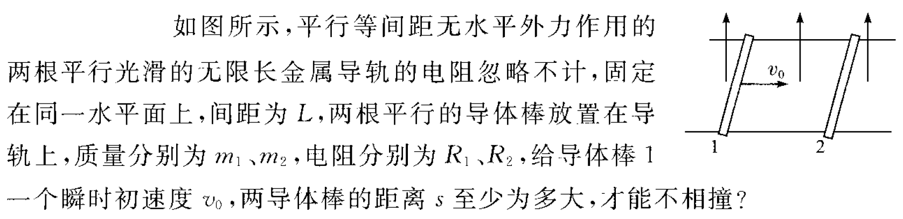
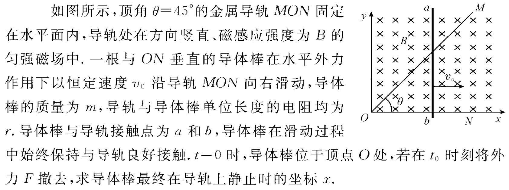
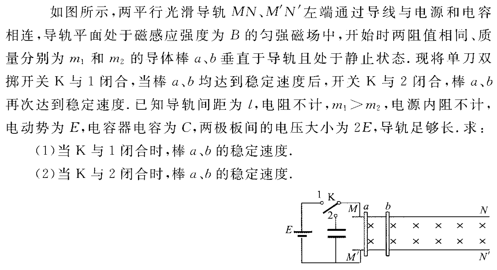

---
authors:
    - AIGC
---

# 电磁感应动量模型经典三题

作为本笔记[电磁感应-动量方法](https://raineblog.dpdns.org/whk/science/electromagnetism/4/#%E5%8A%A8%E9%87%8F%E6%96%B9%E6%B3%95)的补充，我选了三道经典题，巩固这一方法。这三道题目非常经典，且**每一道都完美契合“动量方法”笔记**。下面为你逐题进行最严谨、透彻的物理分析和规范解答。

### 第一题（例 3）

#### 【审题与物理过程分析】

1. **初始状态**：棒 1 获得初速度 $v_0$ 向右运动，棒 2 静止。
2. **受力与运动状态**：
    - 回路磁通量增加，产生感应电流。
    - 由右手定则和左手定则：棒 1 受向左的安培力做**减速运动**；棒 2 受向右的安培力做**加速运动**。
3. **临界不相撞条件**：
    - 棒 1 减速、棒 2 加速，**当两棒速度恰好相等（共速 $v_{\text{共}}$）时，两棒距离达到最小值**。若此时两棒恰好不撞，则之后棒 2 速度将大于棒 1（或相对静止），永远不会相撞。
    - 因此，距离 $s$ 至少为全过程两棒的**相对位移** $\Delta x = x_1 - x_2$。

#### 【规范解答】

**步骤 1：系统动量守恒求共速 $v_{\text{共}}$** 两棒构成的系统在水平方向上只受安培力，安培力为系统内力，合外力为零，系统**总动量守恒**：

$$
m_1 v_0 = (m_1 + m_2) v_{\text{共}}
$$

解得两棒共速：

$$
v_{\text{共}} = \frac{m_1}{m_1 + m_2} v_0
$$

**步骤 2：对棒 2 运用动量定理求电量 $q$** 取向右为正方向，棒 2 初速度为 0，末速度为 $v_{\text{共}}$：

$$
I_{\text{安}} = m_2 v_{\text{共}} - 0
$$

由安培力冲量公式 $I_{\text{安}} = B L q$：

$$
B L q = m_2 \left(\frac{m_1}{m_1 + m_2} v_0\right) = \frac{m_1 m_2}{m_1 + m_2} v_0
$$

解得流过回路的电荷量：

$$
q = \frac{m_1 m_2 v_0}{(m_1 + m_2) B L}
$$

**步骤 3：利用电量与相对位移的关系求 $s$** 回路电阻为 $R_{\text{总}} = R_1 + R_2$。由法拉第电磁感应定律：

$$
q = \frac{\Delta \Phi}{R_1 + R_2} = \frac{B \Delta S}{R_1 + R_2} = \frac{B L (x_1 - x_2)}{R_1 + R_2} = \frac{B L \Delta x}{R_1 + R_2}
$$

两棒不相撞的最小初始距离 $s = \Delta x$：

$$
\Delta x = \frac{q (R_1 + R_2)}{B L}
$$

将 $q$ 代入得：

$$
s \ge \frac{m_1 m_2 (R_1 + R_2) v_0}{(m_1 + m_2) B^2 L^2}
$$

**【答案】** 两导体棒的距离 $s$ 至少为：

$$
\frac{m_1 m_2 (R_1 + R_2) v_0}{(m_1 + m_2) B^2 L^2}
$$

### 第二题（第 1 题）

#### 【审题与物理过程分析】

1. **$0 \sim t_0$ 过程（匀速运动）**：
    - 导体棒在 $t_0$ 时刻的坐标：$x_0 = v_0 t_0$，速度为 $v_0$。
2. **$t_0$ 之后过程（仅受安培力减速至静止）**：
    - 撤去外力 $F$，棒在安培力阻碍下做减速运动，直到速度减为 $0$。
    - **几何与电路特征（陷阱点）**：- 导轨顶角 $\theta = 45^\circ$，在坐标 $x$ 处，两导轨接触点间的有效切割长度：
        $$
        L(x) = x \cdot \tan 45^\circ = x
        $$
    - 回路 $Oab$ 是一个等腰直角三角形，三边长分别为：$x$（底边）、$x$（直角边）、$\sqrt{2}x$（斜边）。
    - 回路总电阻：
        $$
        R_{\text{总}}(x) = r \cdot (x + x + \sqrt{2}x) = (2 + \sqrt{2}) r x
        $$

#### 【规范解答】

**步骤 1：分析瞬时安培力与微元动量方程** 在坐标为 $x$、瞬时速度为 $v$ 时：

- 感应电动势：$E = B \cdot L(x) \cdot v = B x v$
- 感应电流：
    $$
    i = \frac{E}{R_{\text{总}}(x)} = \frac{B x v}{(2 + \sqrt{2}) r x} = \frac{B v}{(2 + \sqrt{2}) r}
    $$
    坐标 $x$ 刚好在分子分母中约掉，电流大小只取决于瞬时速度 $v$！
- 导体棒所受安培力大小：
    $$
    F_{\text{安}} = B i L(x) = B \cdot \frac{B v}{(2 + \sqrt{2}) r} \cdot x = \frac{B^2 x v}{(2 + \sqrt{2}) r}
    $$

**步骤 2：建立微元方程并积分** 取向右为正方向，撤去外力后仅受向左的安培力。在极短时间 $dt$ 内：

$$
-F_{\text{安}} dt = m dv
$$

代入 $F_{\text{安}}$ 表达式，并注意 $v dt = dx$（微元位移）：

$$
-\frac{B^2 x}{(2 + \sqrt{2}) r} \cdot (v dt) = m dv
$$

$$
-\frac{B^2}{(2 + \sqrt{2}) r} x dx = m dv
$$

**步骤 3：定积分求最终坐标 $x$** 从 $t_0$ 时刻（位置 $x_0 = v_0 t_0$，速度 $v_0$）积分到最终停止（位置 $x$，速度 $0$）：

$$
\int_{x_0}^{x} -\frac{B^2}{(2 + \sqrt{2}) r} x dx = \int_{v_0}^{0} m dv
$$

$$
-\frac{B^2}{2(2 + \sqrt{2}) r} \left(x^2 - x_0^2\right) = 0 - m v_0
$$

化简：

$$
x^2 - x_0^2 = \frac{2(2 + \sqrt{2}) m r v_0}{B^2}
$$

代入 $x_0 = v_0 t_0$，解得最终坐标：

$$
x = \sqrt{v_0^2 t_0^2 + \frac{2(2 + \sqrt{2}) m r v_0}{B^2}}
$$

**【答案】**

$$
x = \sqrt{v_0^2 t_0^2 + \frac{2(2 + \sqrt{2}) m r v_0}{B^2}}
$$

### 第三题（第 2 题）

#### 【审题与物理过程分析】

- **导轨结构**：导轨电阻不计，内阻不计。
    - **棒 $a$ 和棒 $b$ 处于并联关系！**
    - 设棒的电阻均为 $R$。

- **过程 (1)：K 接 1（接电源 $E$）**
    - 导轨间直接加上恒定电压 $E$。
    - 两棒受向右的安培力加速，产生反向动生电动势 $E_{\text{反}} = B l v$。

- **过程 (2)：K 切换到 2（接电容 $C$）**
    - 切换前，两棒已有速度 $v_1$。
    - 电容器初始电压大小为 $2E$。
    - 重新并联后充放电，直到电流再次消失（达到新的稳定状态）。

#### 【规范解答】

#### （1）当 K 与 1 闭合时，棒 $a, b$ 的稳定速度

当开关接 1 时，导轨间由理想电源供电，电压恒为 $E$。对任一棒（设其瞬时速度为 $v$）：

- 回路感应反电动势为 $E_{\text{反}} = B l v$
- 棒中的瞬时电流为：$i = \frac{E - B l v}{R}$
- 棒所受向右的安培力：$F_{\text{安}} = B i l = \frac{B l (E - B l v)}{R}$

当两棒速度达到稳定时，棒的加速度为零，电流必须为零：

$$
E - B l v = 0 \implies v = \frac{E}{B l}
$$

因为两棒并联且导轨无电阻，各棒互不干扰，所以：

$$
v_{a1} = v_{b1} = \frac{E}{B l}
$$

#### （2）当 K 与 2 闭合时，棒 $a, b$ 的稳定速度

**步骤 1：判断最终稳定状态的特征** 开关切到 2 后，两棒与电容器并联。若最终达到稳定速度，回路中**电流必须再次为零**（否则安培力不为零，两棒还会继续变速）。电流为零意味着：**两棒产生的感应电动势与电容器两端的最终电压 $U_{\text{终}}$ 处处相等**。

$$
B l v_{a2} = B l v_{b2} = U_{\text{终}} \implies v_{a2} = v_{b2} = v_2
$$

两棒的最终稳定速度依然相同，设为 $v_2$。

**步骤 2：对两棒及电容器运用动量定理** 设整个调整过程中，通过棒 $a$ 的电量为 $q_a$，通过棒 $b$ 的电量为 $q_b$。对棒 $a$ 应用动量定理：

$$
B l q_a = m_1 (v_2 - v_1)
$$

对棒 $b$ 应用动量定理：

$$
B l q_b = m_2 (v_2 - v_1)
$$

两式相加：

$$
B l (q_a + q_b) = (m_1 + m_2)(v_2 - v_1) \qquad (\star)
$$

**步骤 3：电荷量与电容器电压变化的关系** 由电路并联电荷守恒，流过两棒的总电量等于电容器极板上电荷量的变化量：

$$
q_a + q_b = \Delta Q_C = Q_{\text{初}} - Q_{\text{终}}
$$

电容器最终电压为 $U_{\text{终}} = B l v_2$，因此 $Q_{\text{终}} = C \cdot B l v_2$。

> **关于电容器初始极板极性的讨论（体现答题严密性）：** 题图中电源正极在上，若电容器初始充电也是**上极板为正**，则初始电压取 $+2E$；若反向充电，则初始电压取 $-2E$。通常默认为与电源同向极性（上正下负）。

按标准情况（**上极板为正极**）：

$$
Q_{\text{初}} = C \cdot (2E)
$$

代入电量变化量：

$$
q_a + q_b = 2CE - C B l v_2
$$

**步骤 4：联立求解最终速度 $v_2$** 将 $q_a + q_b$ 及 $v_1 = \frac{E}{Bl}$ 代入 $(\star)$ 式：

$$
B l (2CE - C B l v_2) = (m_1 + m_2)\left(v_2 - \frac{E}{B l}\right)
$$

展开整理：

$$
2 B l C E - B^2 l^2 C v_2 = (m_1 + m_2) v_2 - \frac{(m_1 + m_2)E}{B l}
$$

移项并提取公因式：

$$
\left[(m_1 + m_2) + B^2 l^2 C\right] v_2 = \frac{m_1 + m_2}{B l} E + 2 B l C E
$$

通分后解得：

$$
v_2 = \frac{(m_1 + m_2 + 2 B^2 l^2 C) E}{B l (m_1 + m_2 + B^2 l^2 C)}
$$

### 【总结与点拨】

这三道题完整覆盖了你笔记里的三大核心杀招：

1. **双棒无外力**：系统动量守恒求末态 + 动量定理求电量 + $q = \frac{BL\Delta x}{R_{\text{总}}}$ 求相对位移。
2. **变长度切割**：动量定理微元化 $\int x dx$ 与 $\int dv$ 结合。
3. **含容/电源电路**：电荷量与电容公式 $q = C\Delta U$ 结合，直接用动量定理绕过复杂的微积分过渡过程。
