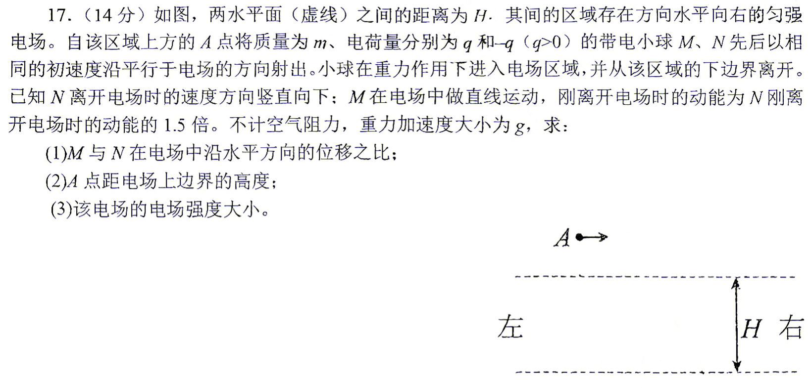

---
authors:
    - AIGC
---

# 2017全国卷二（新课标Ⅱ卷）理综25题

这是一道非常经典的带电粒子（小球）在**分段重力场与复合场**中运动的综合题（2015年全国卷Ⅰ第25题）。解决本题的关键在于运用**分段法**、**运动的合成与分解**以及**动能两点差值法（动能定理）**，抓住两个小球在**竖直方向运动完全相同**这一隐含桥梁。

下面我们从物理过程拆解、分步详细求解、一题多解与核心思想提炼四个方面展开讲解。

### 一、 审题与物理图景拆解

#### 1. 分段建模与轨迹可视化

小球从 $A$ 点水平向右以初速度 $v_0$ 射出，整个运动分为两个区域（**分段法**）：

- **第一阶段（无电场区，高度 $h$）**：两虚线上方没有电场，两小球均只受重力作用，且初位置、初速度 $v_0$ 完全相同，因此**都做完全相同的平抛运动**。
    - 设两球从 $A$ 点运动到电场上边界的时间均为 $t_1$。

    - 到达上边界时，两球速度完全相同：水平分速度均为 $v_0$（向右），竖直分速度均为 $v_{y1} = g t_1$（向下）。

- **第二阶段（匀强电场区，高度 $H$）**：进入两虚线之间后，两球除受重力 $mg$ 外，还受水平电场力：
    - 小球 $M$（带 $+q$）：受**水平向右**的电场力 $F_M = qE$，水平加速度 $a = \frac{qE}{m}$（向右，与 $v_0$ 同向）。题目已知 $M$ **在电场中做直线运动**。

    - 小球 $N$（带 $-q$）：受**水平向左**的电场力 $F_N = qE$，水平加速度大小也为 $a = \frac{qE}{m}$（向左，与 $v_0$ 反向）。题目已知 $N$ **离开电场时速度方向竖直向下**，即离开下边界瞬间水平分速度恰好减为 $0$。

#### 2. 抓核心桥梁：运动的合成与分解

将两球在电场中的运动正交分解为**水平方向（$x$ 轴，向右为正）**和**竖直方向（$y$ 轴，向下为正）**：

- **竖直方向**：由于电场水平，两球在竖直方向**均只受重力**，加速度均为 $g$；进入电场时的竖直初速度均为 $v_{y1}$；在电场中下落的竖直高度均为 $H$。

    $$
    \implies \text{两球在电场中运动的时间 } t_2 \text{ 完全相同，离开电场时的竖直分速度 } v_{y2} \text{ 也完全相同！}
    $$

    （其中 $v_{y2} = v_{y1} + g t_2$）

### 二、 详细分步求解

#### 第 (1) 问：求 $M$ 与 $N$ 在电场中沿水平方向的位移之比

聚焦**水平方向**在电场区内的匀变速直线运动（时间为 $t_2$）：

1. **对小球 $N$**：

    水平方向初速度为 $v_0$，加速度为 $-a$（其中 $a = \frac{qE}{m}$），离开电场时速度竖直向下，说明末态水平分速度 $v_{Nx2} = 0$。

    由速度公式：

    $$
    v_{Nx2} = v_0 - a t_2 = 0 \implies v_0 = a t_2
    $$

    利用平均速度求 $N$ 在电场中的水平位移：

    $$
    x_N = \frac{v_0 + 0}{2} t_2 = \frac{1}{2} v_0 t_2
    $$

2. **对小球 $M$**：

    水平方向初速度为 $v_0$，加速度为 $+a$，运动时间同样为 $t_2$。

    离开电场时的水平分速度：

    $$
    v_{Mx2} = v_0 + a t_2
    $$

    将上面得到的 $a t_2 = v_0$ 代入，得：

    $$
    v_{Mx2} = 2 v_0
    $$

    利用平均速度求 $M$ 在电场中的水平位移：

    $$
    x_M = \frac{v_0 + 2v_0}{2} t_2 = \frac{3}{2} v_0 t_2
    $$

3. **求位移之比**：

    $$
    \frac{x_M}{x_N} = \frac{\frac{3}{2}v_0 t_2}{\frac{1}{2}v_0 t_2} = \frac{3}{1}
    $$

> **【方法拓展：运动学图像应用法】**
>
> 画出两球在电场中的水平方向 $v_x - t$ 图像（从 $t=0$ 到 $t=t_2$）：
>
> - $N$ 的图线是从 $(0, v_0)$ 倾斜下降到 $(t_2, 0)$ 的线段，与时间轴围成**三角形**，面积 $x_N = \frac{1}{2}v_0 t_2$；
>
> - $M$ 的图线与 $N$ 斜率等大反向，从 $(0, v_0)$ 倾斜上升到 $(t_2, 2v_0)$，与时间轴围成**梯形**，面积可分割为 $3$ 个与 $N$ 相同的直角三角形，故 $x_M : x_N = 3 : 1$。

#### 第 (2) 问：求 $A$ 点距电场上边界的高度 $h$

聚焦条件：**“$M$ 在电场中做直线运动”**。

1. **物体做直线运动的动力学条件**：

    $M$ 进入电场后受到恒定的合力 $\vec{F}_{\text{合}} = (qE, mg)$（即恒定加速度 $\vec{a}_{\text{合}} = (a, g)$）。要使 $M$ 做直线运动，其刚进入电场时的速度 $\vec{v}_1 = (v_0, v_{y1})$ 必须与合力 $\vec{F}_{\text{合}}$（或加速度 $\vec{a}_{\text{合}}$）**方向共线**，即水平分量与竖直分量之比相等：

    $$
    \frac{v_0}{v_{y1}} = \frac{a}{g}
    $$

2. **联立时间关系**：

    由第 (1) 问已知 $v_0 = a t_2$，又因为在无电场区竖直方向做自由落体运动，进入电场时 $v_{y1} = g t_1$。将两式代入共线条件：

    $$
    \frac{a t_2}{g t_1} = \frac{a}{g} \implies t_1 = t_2
    $$

    **这是一个非常漂亮的结论**：小球在无电场区下落的时间 $t_1$ 与在电场区下落的时间 $t_2$ 恰好相等！

3. **求高度 $h$**：

    观察整个竖直方向的运动：从 $A$ 点开始做初速度为 $0$、加速度为 $g$ 的自由落体运动：
    - 第一段（无电场区，用时 $t_1$）：

        $$
        h = \frac{1}{2} g t_1^2
        $$

    - 第二段（电场区，用时 $t_2 = t_1$）：

        $$
        H = v_{y1} t_2 + \frac{1}{2} g t_2^2 = (g t_1) t_1 + \frac{1}{2} g t_1^2 = \frac{3}{2} g t_1^2
        $$

    两式相比：

    $$
    \frac{h}{H} = \frac{1}{3} \implies h = \frac{1}{3}H
    $$

> **【秒杀技巧】** 初速度为零的匀加速直线运动，在连续相等时间 $t_1 = t_2$ 内的位移之比为 $1 : 3$，直接可得 $h : H = 1 : 3$，即 $h = \frac{1}{3}H$。

#### 第 (3) 问：求该电场的电场强度大小 $E$

聚焦条件：**“$M$ 刚离开电场时的动能为 $N$ 刚离开电场时的动能的 $1.5$ 倍”**。这里提供两种思路：

##### 方法一：速度合成法（最直接）

1. 由第 (2) 问知 $t_1 = t_2$，因此离开电场时的竖直分速度为：

    $$
    v_{y2} = v_{y1} + g t_2 = g t_1 + g t_1 = 2 v_{y1}
    $$

2. 由第 (1) 问知 $M$ 离开电场时的水平分速度为：

    $$
    v_{Mx2} = 2 v_0
    $$

    而 $N$ 离开电场时水平分速度为 $v_{Nx2} = 0$，总速度即为 $v_{y2}$。

3. 根据动能之比 $E_{kM} = 1.5 E_{kN} = \frac{3}{2} E_{kN}$：

    $$
    \frac{1}{2} m (v_{Mx2}^2 + v_{y2}^2) = \frac{3}{2} \left( \frac{1}{2} m v_{y2}^2 \right)
    $$

    两边约去 $\frac{1}{2}m$：

    $$
    v_{Mx2}^2 + v_{y2}^2 = \frac{3}{2} v_{y2}^2 \implies v_{Mx2}^2 = \frac{1}{2} v_{y2}^2
    $$

    代入 $v_{Mx2} = 2v_0$ 和 $v_{y2} = 2v_{y1}$：

    $$
    (2v_0)^2 = \frac{1}{2} (2v_{y1})^2 \implies \frac{v_0}{v_{y1}} = \frac{1}{\sqrt{2}}
    $$

4. 结合 $M$ 做直线运动时的共线关系 $\frac{a}{g} = \frac{v_0}{v_{y1}}$：

    $$
    \frac{qE}{mg} = \frac{a}{g} = \frac{1}{\sqrt{2}} \implies E = \frac{\sqrt{2}mg}{2q}
    $$

##### 方法二：动能两点差值法（动能定理全程法）

如果从**能量转化**的角度看，对两球从 $A$ 点到下边界的全过程分别应用动能定理：

- 两球初动能均为 $E_{k0} = \frac{1}{2} m v_0^2$，重力做功均为 $W_G = mg(h+H)$。

- 对 $N$：电场力做负功减速至水平速度为 $0$，故 $W_{EN} = -qE x_N = 0 - \frac{1}{2} m v_0^2$。

    因此 $N$ 离开电场时的动能为：

    $$
    E_{kN} = \frac{1}{2} m v_0^2 + mg(h+H) - \frac{1}{2} m v_0^2 = mg(h+H)
    $$

- 对 $M$：由第 (1) 问 $x_M = 3 x_N$，故电场力对 $M$ 做的正功为：

    $$
    W_{EM} = qE x_M = 3 qE x_N = \frac{3}{2} m v_0^2
    $$

    因此 $M$ 离开电场时的动能为：

    $$
    E_{kM} = \frac{1}{2} m v_0^2 + mg(h+H) + \frac{3}{2} m v_0^2 = 2 m v_0^2 + mg(h+H)
    $$

- 代入 $E_{kM} = 1.5 E_{kN}$：

    $$
    2 m v_0^2 + mg(h+H) = 1.5 mg(h+H) \implies 2 m v_0^2 = \frac{1}{2} mg(h+H)
    $$

    将第 (2) 问 $h = \frac{1}{3}H$（即 $h+H = \frac{4}{3}H$）代入，得：

    $$
    v_0^2 = \frac{1}{4} g \left(\frac{4}{3}H\right) = \frac{1}{3}gH
    $$

- 又因为 $v_{y1}^2 = 2gh = \frac{2}{3}gH$，结合直线运动条件 $\frac{qE}{mg} = \frac{v_0}{v_{y1}} = \sqrt{\frac{\frac{1}{3}gH}{\frac{2}{3}gH}} = \frac{\sqrt{2}}{2}$，同样解得：

    $$
    E = \frac{\sqrt{2}mg}{2q}
    $$

### 三、 总结与易错点提醒

1. **最终答案**：
    - (1) 水平位移之比 $x_M : x_N = 3 : 1$；

    - (2) $A$ 点距电场上边界的高度 $h = \frac{1}{3}H$；

    - (3) 电场强度大小 $E = \frac{\sqrt{2}mg}{2q}$。

2. **核心思想方法回顾**：
    - **分段法**：将复合运动拆分为“纯重力场平抛”与“重力+电场复合运动”两个阶段，上边界处的状态是两段的衔接点。

    - **运动的合成与分解**：在水平方向各自匀变速、竖直方向运动完全一致，从而锁定“时间 $t_2$ 相同”和“末态竖直分速度 $v_{y2}$ 相同”。

    - **直线运动条件**：恒力作用下物体做直线运动 $\iff$ 合外力方向与初速度方向共线（即 $\frac{v_0}{v_{y1}} = \frac{qE}{mg}$），这是打通第 (2)、(3) 问的题眼。

3. **三大常见易错点**：
    - **误解“速度方向竖直向下”**：只意味着水平分速度 $v_{Nx2} = 0$，**不是**总速度为 $0$，求 $E_{kN}$ 时千万不能漏掉竖直分速度 $v_{y2}$。

    - **误认为 $M$ 做直线运动是在做水平/竖直运动**：由于重力竖直向下、电场力水平向右，合力斜向右下方，$M$ 做的是**倾斜的匀加速直线运动**，因此必须在**进入电场的瞬间**满足速度偏角与合力偏角一致。

    - **没化简出 $t_1 = t_2$**：在求第 (2) 问时，若过早把 $v_0, E$ 当作未知数硬算方程组会非常繁琐；利用第 (1) 问的 $v_0 = a t_2$ 与直线条件 $\frac{v_0}{v_{y1}} = \frac{a}{g}$ 消去 $a$，即可一步秒出 $t_1 = t_2$。
