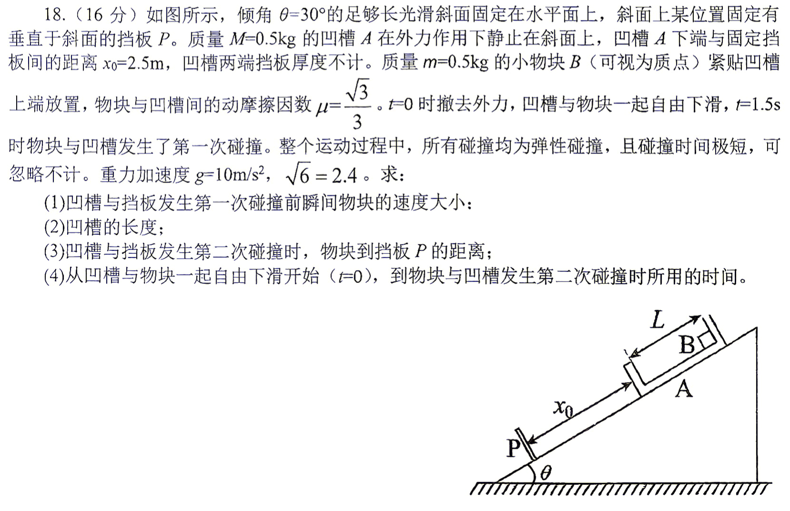

---
authors:
    - AIGC
    - RainPPR
---

# 2026济南一模物理17题

为了让你彻底跟上推导节奏、不掉进“计算泥潭”或“跳跃式思维链”里，我们先花 1 分钟把第（1）（2）问顺带提供的**通用物理地基**夯实，然后专门针对**第（3）问**展开 **4 种不同层次与视角的完整推演**。

全程不出现“联立解得”“观察到”“归纳得出”这类偷懒的跳步词，每一步变形和代入都写明白。

### 第 0 步：夯实前置地基（确定物理常量与“进出方向”规则）

先理清两个区域的受力特征和基本常量：

1. **电场区（$x < 0$）的运动特征**

    电场方向与 $+x$ 轴、$-y$ 轴夹角均为 $45^\circ$，将电场强度 $\vec{E}$ 正交分解到 $x, y$ 轴：

    $$
    E_x = E\cos 45^\circ = \frac{\sqrt{2}}{2}E, \qquad E_y = -E\sin 45^\circ = -\frac{\sqrt{2}}{2}E
    $$

    因为粒子带正电，所以在 $x < 0$ 区域内加速度恒为：

    $$
    a_x = \frac{qE_x}{m}, \qquad a_y = \frac{qE_y}{m} = -a_x
    $$

    再看从 $P(-L, L)$ 静止释放到 $O(0, 0)$ 的过程：位移向量 $\vec{PO} = (L, -L)$，正好沿着电场方向，距离为 $\sqrt{2}L$。到达 $O$ 点（**第 1 次经过 $y$ 轴**）时速度大小为 $v_0$，其速度分量为：

    $$
    v_{1x} = v_0\cos 45^\circ = \frac{\sqrt{2}}{2}v_0, \qquad v_{1y} = -v_0\sin 45^\circ = -\frac{\sqrt{2}}{2}v_0
    $$

    在 $x$ 方向上，由匀加速公式 $v_{1x}^2 - 0 = 2a_x L$，把 $v_{1x} = \frac{\sqrt{2}}{2}v_0$ 代入：

    $$
    \left(\frac{\sqrt{2}}{2}v_0\right)^2 = 2a_x L \implies \frac{1}{2}v_0^2 = 2a_x L \implies a_x = \frac{v_0^2}{4L}
    $$

    由此立刻得到电场区的核心加速度常数：

    $$
    a_x = \frac{v_0^2}{4L}, \qquad a_y = -\frac{v_0^2}{4L}
    $$

    （顺便记下动能定理版关系：从 $P \to O$，合外力做功 $qE_x L + qE_y(-L) = \frac{1}{2}mv_0^2$；因为 $E_x = -E_y$，左边等于 $-2qE_y L$，所以 $qE_y = -\frac{mv_0^2}{4L}$，后面方法三会直接用到。）

2. **磁场区（$x > 0$）的初始常量**

    粒子以 $v_0$ 从 $O(0, 0)$ 进入 $x > 0$（$\vec{B}$ 垂直纸面向外），与 $-y$ 轴夹角为 $45^\circ$。由左手定则，洛伦兹力指向第三象限（使粒子顺时针偏转），从 $Q(0, -2L)$ **第 2 次经过 $y$ 轴**。

    在圆弧 $OQ$ 中，弦长 $OQ = 2L$，弦切角（速度与 $-y$ 轴夹角）为 $45^\circ$，根据几何关系 $OQ = 2R_1\sin 45^\circ$：

    $$
    2L = 2R_1 \cdot \frac{\sqrt{2}}{2} \implies R_1 = \sqrt{2}L
    $$

    又因为 $R_1 = \frac{mv_0}{qB}$，把 $R_1 = \sqrt{2}L$ 代入，得出磁场区核心常量组合：

    $$
    \frac{m}{qB} = \frac{\sqrt{2}L}{v_0}
    $$

3. **建立“奇偶穿越”路标（防迷路关键）**
    - 第 $1$ 次过 $y$ 轴（$O$ 点）：从左向右进入**磁场**（$x>0$）；

    - 第 $2$ 次过 $y$ 轴（$Q$ 点）：从右向左进入**电场**（$x<0$）；

    - 依此类推：凡是**奇数次**（$n=1,3,5,\dots$）经过 $y$ 轴，都是**出电场、进磁场**（$v_x > 0$）；凡是**偶数次**（$n=2,4,6,\dots$）经过 $y$ 轴，都是**出磁场、进电场**（$v_x < 0$）。

记第 $n$ 次经过 $y$ 轴的纵坐标为 $y_n$，瞬时速度分量为 $(v_{nx}, v_{ny})$。下面正式用 **4 种方法**求解 $y_n$。

### 方法一：高中物理常用法——逐次拆解计算 + 物理增量归纳

> **核心导航**：先把前几段（$n=1 \to 2 \to 3 \to 4 \to 5 \to 6$）老老实实算清楚，但在找规律时**不硬猜坐标数字 $0, -2, -10, -12, -28$**，而是拆出“磁场位移增量”和“电场位移增量”各自的物理增长原因，顺理成章求和推出通式。

#### 第一步：打通“一般磁场段”的几何规律（算出为什么每次都向下移 $2L$）

假设某次（奇数次 $n=2k-1$）粒子以速度 $(v_x, v_y)$（其中 $v_x > 0, v_y < 0$）进入 $x > 0$：

1. 速率 $v = \sqrt{v_x^2 + v_y^2}$，运动半径 $R = \frac{mv}{qB}$。

2. 速度方向与 $-y$ 轴（即 $y$ 轴边界）的夹角设为 $\beta$，则 $\sin\beta = \frac{v_x}{v}$。

3. 这条圆弧落在 $y$ 轴上的弦长 $d$（弦切角等于 $\beta$，对应圆心角等于 $2\beta$）为：

    $$
    d = 2R\sin\beta = 2\left(\frac{mv}{qB}\right)\left(\frac{v_x}{v}\right) = \frac{2m v_x}{qB}
    $$

    看！总速率 $v$ 在分子分母里**恰好消掉了**，弦长只取决于 $v_x$！

4. 由于弦在竖直方向（$y$ 轴）上，圆弧关于水平对称轴对称，且粒子向下偏转，所以从进入磁场到离开磁场：
    - 纵坐标变化：$\Delta y_B = -d = -\frac{2mv_x}{qB}$；

    - 离开时 $y$ 方向速度不变：$v_{y\text{出}} = v_y$；

    - 离开时 $x$ 方向速度反向：$v_{x\text{出}} = -v_x$。

#### 第二步：打通“一般电场段”的时间与速度规律

粒子离开磁场进入 $x < 0$ 时，$v_{x\text{入}} < 0$，随后在 $x$ 方向做匀变速运动（$a_x = \frac{v_0^2}{4L} > 0$）直到回到 $x = 0$。

设这次在电场中运动时间为 $t_E$，由 $x$ 方向位移为零：

$$
v_{x\text{入}} t_E + \frac{1}{2}a_x t_E^2 = 0 \implies t_E = \frac{-2v_{x\text{入}}}{a_x}
$$

返回 $x=0$ 时的 $x$ 方向速度为：

$$
v_{x\text{出}} = v_{x\text{入}} + a_x t_E = v_{x\text{入}} + a_x\left(\frac{-2v_{x\text{入}}}{a_x}\right) = -v_{x\text{入}}
$$

把磁场段和电场段的 $v_x$ 变化串起来看：

- 第 $1$ 次进磁场：$v_{1x} = +\frac{\sqrt{2}}{2}v_0$；

- 磁场反号，第 $2$ 次进电场：$v_{2x} = -\frac{\sqrt{2}}{2}v_0$；

- 电场反号，第 $3$ 次进磁场：$v_{3x} = +\frac{\sqrt{2}}{2}v_0$；

- ……以此往复，每次经过 $y$ 轴时 $x$ 分速度大小永远不变，恒为 $\frac{\sqrt{2}}{2}v_0$！

因此立刻锁定两个**永不变的周期常数**：

1. **每次在磁场中的位移恒为**：

    把 $v_x = \frac{\sqrt{2}}{2}v_0$ 和 $\frac{m}{qB} = \frac{\sqrt{2}L}{v_0}$ 代入 $\Delta y_B = -\frac{2mv_x}{qB}$：

    $$
    \Delta y_B = -2 \cdot \frac{\sqrt{2}L}{v_0} \cdot \frac{\sqrt{2}}{2}v_0 = -2L
    $$

2. **每次在电场中的运动时间恒为**：

    把 $v_{x\text{入}} = -\frac{\sqrt{2}}{2}v_0$ 和 $a_x = \frac{v_0^2}{4L}$ 代入 $t_E = \frac{-2v_{x\text{入}}}{a_x}$：

    $$
    t_E = \frac{2 \cdot \frac{\sqrt{2}}{2}v_0}{\frac{v_0^2}{4L}} = \frac{4\sqrt{2}L}{v_0}
    $$

3. **每次在电场中 $y$ 方向速度的增量恒为**：

    $$
    \Delta v_y = a_y t_E = \left(-\frac{v_0^2}{4L}\right)\left(\frac{4\sqrt{2}L}{v_0}\right) = -\sqrt{2}v_0
    $$

#### 第三步：手算前 6 次过 $y$ 轴坐标，解剖“增量结构”

利用上面算出的固定增量 $\Delta y_B = -2L$、$t_E = \frac{4\sqrt{2}L}{v_0}$、$\Delta v_y = -\sqrt{2}v_0$，逐次往后算：

- **$n = 1$（$O$ 点）**：$y_1 = 0$，$v_{1y} = -\frac{\sqrt{2}}{2}v_0$。

- **$n = 2$（经第 1 次磁场到达 $Q$ 点）**：

    $$
    y_2 = y_1 + \Delta y_B = -2L, \qquad v_{2y} = v_{1y} = -\frac{\sqrt{2}}{2}v_0
    $$

- **$n = 3$（经第 1 次电场）**：

    $$
    v_{3y} = v_{2y} + \Delta v_y = -\frac{\sqrt{2}}{2}v_0 - \sqrt{2}v_0 = -\frac{3\sqrt{2}}{2}v_0
    $$

    用匀变速公式算这趟电场位移 $\Delta y_{E1}$：

    $$
    \Delta y_{E1} = v_{2y}t_E + \frac{1}{2}a_y t_E^2 = \left(-\frac{\sqrt{2}}{2}v_0\right)\frac{4\sqrt{2}L}{v_0} + \frac{1}{2}\left(-\frac{v_0^2}{4L}\right)\left(\frac{4\sqrt{2}L}{v_0}\right)^2 = -4L - 4L = -8L
    $$

    故 $y_3 = y_2 + \Delta y_{E1} = -2L - 8L = -10L$。

- **$n = 4$（经第 2 次磁场）**：

    $$
    y_4 = y_3 + \Delta y_B = -10L - 2L = -12L, \qquad v_{4y} = v_{3y} = -\frac{3\sqrt{2}}{2}v_0
    $$

- **$n = 5$（经第 2 次电场）**：

    $$
    v_{5y} = v_{4y} + \Delta v_y = -\frac{5\sqrt{2}}{2}v_0
    $$

    这趟电场位移 $\Delta y_{E2}$：

    $$
    \Delta y_{E2} = v_{4y}t_E + \frac{1}{2}a_y t_E^2 = \left(-\frac{3\sqrt{2}}{2}v_0\right)\frac{4\sqrt{2}L}{v_0} - 4L = -12L - 4L = -16L
    $$

    故 $y_5 = y_4 + \Delta y_{E2} = -12L - 16L = -28L$。

- **$n = 6$（经第 3 次磁场）**：

    $$
    y_6 = y_5 + \Delta y_B = -28L - 2L = -30L, \qquad v_{6y} = -\frac{5\sqrt{2}}{2}v_0
    $$

- **$n = 7$（经第 3 次电场，可再算一次核对）**：

    $$
    \Delta y_{E3} = v_{6y}t_E - 4L = \left(-\frac{5\sqrt{2}}{2}v_0\right)\frac{4\sqrt{2}L}{v_0} - 4L = -20L - 4L = -24L \implies y_7 = -54L
    $$

#### 第四步：不是“瞎猜数字”，而是对“增量规律”做精确累加

看看每次电场的位移为什么精准地呈现 $-8L, -16L, -24L, \dots$：

因为进入第 $m$ 次电场时，初速度比进入第 $m-1$ 次电场时多了一个 $\Delta v_y = -\sqrt{2}v_0$，所以 $v_{y\text{入}} t_E$ 这一项就固定多出 $(-\sqrt{2}v_0)\cdot \frac{4\sqrt{2}L}{v_0} = -8L$，而 $\frac{1}{2}a_y t_E^2 = -4L$ 不变。

因此，**第 $m$ 次电场位移精确等于 $-8mL$**（$m=1,2,3,\dots$）！

下面按奇偶分情况把每段增量加起来：

1. **当 $n$ 为奇数时**，设 $n = 2k - 1$（$k = 1, 2, 3, \dots$）：

    从 $O$ 点（$n=1$）到第 $2k-1$ 次经过 $y$ 轴，粒子一共经历了 $(k-1)$ 次磁场段和 $(k-1)$ 次电场段。把这两部分增量相加：

    $$
    y_{2k-1} = \underbrace{(-2L) + (-2L) + \dots + (-2L)}_{k-1 \text{ 项}} + \underbrace{(-8L) + (-16L) + \dots + [-8(k-1)L]}_{k-1 \text{ 项}}
    $$

    后半部分用等差数列求和公式（首项 $-8L$，末项 $-8(k-1)L$，项数 $k-1$）：

    $$
    y_{2k-1} = -2(k-1)L - 8L \cdot \frac{[1 + (k-1)] (k-1)}{2} = -2(k-1)L - 4k(k-1)L
    $$

    提取公因式 $-(k-1)L$：

    $$
    y_{2k-1} = -(k-1)(4k + 2)L = -2(k-1)(2k + 1)L
    $$

    把 $k = \frac{n+1}{2}$ 代入替换 $k$（注意 $2(k-1) = n-1$，$2k+1 = n+2$）：

    $$
    y_n = -(n-1)(n+2)L \qquad (n = 1, 3, 5, \dots)
    $$

2. **当 $n$ 为偶数时**，设 $n = 2k$（$k = 1, 2, 3, \dots$）：

    第 $2k$ 次不过是在第 $2k-1$ 次之后再走一段磁场位移 $-2L$：

    $$
    y_{2k} = y_{2k-1} - 2L = -2(k-1)(2k+1)L - 2L = -2\left[(2k^2 - k - 1) + 1\right]L = -2k(2k-1)L
    $$

    把 $2k = n$ 代入：

    $$
    y_n = -n(n-1)L \qquad (n = 2, 4, 6, \dots)
    $$

### 方法二：基础高中数学法——建立代数递推方程 + 数列严密推演

> **核心导航**：不算具体的 $n=3,4,5$，而是直接把任意第 $2k-1$、$2k$、$2k+1$ 次跨越抽象成符号关系，用高中数列的**奇偶拆项、等差通项、累加法**严密推出通项公式。

#### 第一步：建立任意跨度（$2k-1 \to 2k \to 2k+1$）的速度递推关系

1. **磁场过程（$2k-1 \to 2k$，$k \ge 1$）**：

    同方法一由圆弧弦长与对称性（$d = \frac{2mv_{2k-1, x}}{qB}$）：

    $$
    \begin{cases} v_{2k, x} = -v_{2k-1, x} \\ v_{2k, y} = v_{2k-1, y} \\ y_{2k} - y_{2k-1} = -\dfrac{2mv_{2k-1, x}}{qB} \end{cases} \qquad \text{(式 1)}
    $$

2. **电场过程（$2k \to 2k+1$，$k \ge 1$）**：

    粒子从 $x=0$ 以 $v_{2k, x} < 0$ 进入 $x<0$，再返回 $x=0$。由 $x$ 方向位移公式 $v_{2k, x}t_k + \frac{1}{2}a_x t_k^2 = 0$，解得该次电场滞留时间：

    $$
    t_k = \frac{-2v_{2k, x}}{a_x}
    $$

    将 $t_k$ 代入速度时间公式，得到：

    $$
    v_{2k+1, x} = v_{2k, x} + a_x t_k = v_{2k, x} - 2v_{2k, x} = -v_{2k, x} \qquad \text{(式 2)}
    $$

    $$
    v_{2k+1, y} = v_{2k, y} + a_y t_k = v_{2k, y} + (-a_x)\left(\frac{-2v_{2k, x}}{a_x}\right) = v_{2k, y} + 2v_{2k, x} \qquad \text{(式 3)}
    $$

    位移由平均速度乘时间给出：

    $$
    y_{2k+1} - y_{2k} = \frac{v_{2k, y} + v_{2k+1, y}}{2} t_k \qquad \text{(式 4)}
    $$

#### 第二步：利用递推式求速度数列 $\{v_{nx}\}$ 与 $\{v_{ny}\}$ 的通项

1. **求 $\{v_{nx}\}$**：

    把(式 1)第一式代入(式 2)：$v_{2k+1, x} = -(-v_{2k-1, x}) = v_{2k-1, x}$。

    说明 $\{v_{2k-1, x}\}$ 是**常数列**！由初值 $v_{1x} = \frac{\sqrt{2}}{2}v_0$，对所有 $k \ge 1$ 均有：

    $$
    v_{2k-1, x} = \frac{\sqrt{2}}{2}v_0, \qquad v_{2k, x} = -\frac{\sqrt{2}}{2}v_0
    $$

    立刻顺带确定 $t_k$ 也是常数：

    $$
    t_k = \frac{-2\left(-\frac{\sqrt{2}}{2}v_0\right)}{\frac{v_0^2}{4L}} = \frac{4\sqrt{2}L}{v_0}
    $$

2. **求 $\{v_{ny}\}$**：

    把 $v_{2k, y} = v_{2k-1, y}$ 与 $v_{2k, x} = -\frac{\sqrt{2}}{2}v_0$ 一并代入(式 3)：

    $$
    v_{2k+1, y} = v_{2k-1, y} + 2\left(-\frac{\sqrt{2}}{2}v_0\right) = v_{2k-1, y} - \sqrt{2}v_0
    $$

    写成差分形式：$v_{2k+1, y} - v_{2k-1, y} = -\sqrt{2}v_0$。

    这说明奇数项子数列 $\{v_{2k-1, y}\}$ 是首项为 $v_{1y} = -\frac{\sqrt{2}}{2}v_0$、公差为 $-\sqrt{2}v_0$ 的**等差数列**！

    直接写出其通项公式（再结合 $v_{2k, y} = v_{2k-1, y}$）：

    $$
    v_{2k, y} = v_{2k-1, y} = -\frac{\sqrt{2}}{2}v_0 + (k - 1)(-\sqrt{2}v_0) = -\left(k - \frac{1}{2}\right)\sqrt{2}v_0
    $$

    把 $k$ 换成 $k+1$，顺手写出下一项备用：

    $$
    v_{2k+1, y} = -\left(k + \frac{1}{2}\right)\sqrt{2}v_0
    $$

#### 第三步：建立坐标数列 $\{y_n\}$ 的递推方程，并用“累加法”求通项

1. 把 $v_{2k-1, x} = \frac{\sqrt{2}}{2}v_0$ 和 $\frac{m}{qB} = \frac{\sqrt{2}L}{v_0}$ 代入(式 1)第三式：

    $$
    y_{2k} - y_{2k-1} = -2 \cdot \frac{\sqrt{2}L}{v_0} \cdot \frac{\sqrt{2}}{2}v_0 = -2L \qquad \text{(式 5)}
    $$

2. 把上面求出的 $v_{2k, y}$、$v_{2k+1, y}$ 和 $t_k = \frac{4\sqrt{2}L}{v_0}$ 代入(式 4)：

    $$
    y_{2k+1} - y_{2k} = \frac{-\left(k - \frac{1}{2}\right)\sqrt{2}v_0 - \left(k + \frac{1}{2}\right)\sqrt{2}v_0}{2} \cdot \frac{4\sqrt{2}L}{v_0} = (-k\sqrt{2}v_0) \cdot \frac{4\sqrt{2}L}{v_0} = -8kL \qquad \text{(式 6)}
    $$

3. 将(式 5)与(式 6)相加，消去中间项 $y_{2k}$，得到纯粹关于奇数项的递推关系：

    $$
    y_{2k+1} - y_{2k-1} = -(8k + 2)L
    $$

4. **使用“累加法”求 $y_{2k-1}$**：

    令 $j$ 从 $1$ 取到 $k-1$（先假定 $k \ge 2$），把所有奇数步差值累加：

    $$
    y_{2k-1} - y_1 = \sum_{j=1}^{k-1} (y_{2j+1} - y_{2j-1}) = -\sum_{j=1}^{k-1} (8j + 2)L
    $$

    已知 $y_1 = 0$，右侧括号内是一个以 $10$ 为首项、以 $8(k-1)+2$ 为末项、共 $k-1$ 项的等差数列：

    $$
    y_{2k-1} = -\frac{[10 + (8k - 6)](k - 1)}{2}L = -(4k + 2)(k - 1)L = -2(k - 1)(2k + 1)L
    $$

    检验 $k = 1$：上式给出 $y_1 = 0$，与实际相符，故该通项对所有 $k \ge 1$ 成立。

5. **换回原变量 $n$**：
    - 若 $n$ 为奇数，令 $n = 2k - 1$，则 $2(k-1) = n-1$，$2k+1 = n+2$，代入得：

        $$
        y_n = -(n-1)(n+2)L
        $$

    - 若 $n$ 为偶数，令 $n = 2k$，由(式 5)有 $y_{2k} = y_{2k-1} - 2L$：

        $$
        y_{2k} = -2(k-1)(2k+1)L - 2L = -2(2k^2 - k)L = -2k(2k-1)L
        $$

        把 $2k = n$ 代入得：

        $$
        y_n = -n(n-1)L
        $$

> **附：如何将奇偶分段式合并成一个统一通项？**
>
> 展开奇数式：$-(n^2 + n - 2)L$；展开偶数式：$-(n^2 - n)L$。
>
> 取二者的平均值：$\frac{(n^2+n-2)+(n^2-n)}{2} = n^2 - 1$；取半差值：$\frac{(n^2+n-2)-(n^2-n)}{2} = n - 1$。
>
> 用 $(-1)^n$ 调节符号（奇负偶正），得：
>
> $$
> y_n = -\left[(n^2 - 1) - (-1)^n (n - 1)\right]L = -(n-1)\left[n + 1 - (-1)^n\right]L
> $$

### 方法三：数理结合进阶法（1）——微元积分冲量法 + 动量-能量联合法

> **核心导航**：这是计算量**压到极致**的一种物理视角。我们借助高一档的“微元冲量积分”和“矢量对称性”，**全程不求加速度 $a_x, a_y$，不求运动时间 $t_E$，不画圆心找半径，也不用数列累加**！仅凭**动量定理**直接拍出速度 $v_{ny}$，再凭**动能定理**一步算穿 $y_n$！

#### 第一步：两行微元积分，拿下磁场“冲量-位移”二级结论

在 $x > 0$ 磁场中，对任意时刻速度 $\vec{v} = (v_x, v_y)$，由 $\vec{F}_B = q\vec{v} \times \vec{B}$（或左手定则拆解 $v_x, v_y$ 分量受力），洛伦兹力分量为：

$$
F_{Bx} = qBv_y, \qquad F_{By} = -qBv_x
$$

在微元时间 $\mathrm{d}t$ 内列动量定理（注意 $v_y\,\mathrm{d}t = \mathrm{d}y$，$v_x\,\mathrm{d}t = \mathrm{d}x$）：

$$
\begin{cases} m\,\mathrm{d}v_x = F_{Bx}\,\mathrm{d}t = qBv_y\,\mathrm{d}t = qB\,\mathrm{d}y \\ m\,\mathrm{d}v_y = F_{By}\,\mathrm{d}t = -qBv_x\,\mathrm{d}t = -qB\,\mathrm{d}x \end{cases}
$$

对单次穿过磁场区（从 $x=0$ 到 $x=0$，净水平位移 $\Delta x = 0$）积分：

1. 由第二式：$m(v_{y\text{出}} - v_{y\text{入}}) = -qB\Delta x = 0 \implies v_{y\text{出}} = v_{y\text{入}}$。

2. 磁场不做功，速率不变，故 $v_{x\text{出}}^2 + v_{y\text{出}}^2 = v_{x\text{入}}^2 + v_{y\text{入}}^2 \implies |v_{x\text{出}}| = |v_{x\text{入}}|$，且进出方向相反，故 $v_{x\text{出}} = -v_{x\text{入}}$。

3. 由第一式：$m(v_{x\text{出}} - v_{x\text{入}}) = qB\Delta y_B \implies -2mv_{x\text{入}} = qB\Delta y_B \implies \Delta y_B = -\frac{2mv_{x\text{入}}}{qB}$。

而进入电场 $x<0$ 后，$x$ 方向只受恒力 $qE_x$，回到 $x=0$ 时 $\Delta x = 0$，由 $x$ 方向动能定理（或匀变速对称性）必有 $v_{x\text{出}} = -v_{x\text{入}}$。

由此直接确认：每次穿越 $y$ 轴时 $|v_{nx}| = v_{1x} = \frac{\sqrt{2}}{2}v_0$ 恒定，因此**每次磁场位移 $\Delta y_B$ 均等于第 1 次的结果 $-2L$**！

#### 第二步：跳过时间 $t$，用“力分量对称性 + 动量定理”直接求 $v_{ny}$

看 $x < 0$ 的电场区：因为角度 $\theta = 45^\circ$，所以任意时刻电场力严格满足 $F_{Ey} = -F_{Ex}$。

把动量定理写到时间微元上再积分，根本不需要管在电场里待了多久：

$$
m\Delta v_y = \int F_{Ey}\,\mathrm{d}t = -\int F_{Ex}\,\mathrm{d}t = -m\Delta v_x
$$

每次电场过程，粒子从 $v_{x\text{入}} = -\frac{\sqrt{2}}{2}v_0$ 变为 $v_{x\text{出}} = +\frac{\sqrt{2}}{2}v_0$，故 $\Delta v_x = +\sqrt{2}v_0$。代入上式立刻得到每次电场的速度增量：

$$
\Delta v_y = -\sqrt{2}v_0
$$

（而磁场过程前面已证 $\Delta v_y = 0$！）

现在数一下次数：设从 $O$ 点（$n=1$）出发，到第 $n$ 次经过 $y$ 轴为止，粒子一共经历了 $N_B$ 次磁场和 $N_E$ 次电场（先保留符号 $N_B, N_E$，最后再按奇偶代进去，防晕！）。

初速度 $v_{1y} = -\frac{\sqrt{2}}{2}v_0$，每过 1 次电场就减去 $\sqrt{2}v_0$，所以第 $n$ 次经过 $y$ 轴时：

$$
v_{ny} = -\frac{\sqrt{2}}{2}v_0 - N_E \sqrt{2}v_0 = -\left(N_E + \frac{1}{2}\right)\sqrt{2}v_0
$$

（顺便一眼核对第 2 问：$n=3$ 时只经历了 $1$ 次电场，即 $N_E = 1$，马上算出 $|v_{3y}| = \frac{3\sqrt{2}}{2}v_0$！）

#### 第三步：跳过数列求和，用“全局动能定理”直接拍出 $y_n$

先算第 $n$ 次过 $y$ 轴时的总速率平方 $v_n^2$：

$$
v_n^2 = v_{nx}^2 + v_{ny}^2 = \left(\frac{\sqrt{2}}{2}v_0\right)^2 + \left[\left(N_E + \frac{1}{2}\right)\sqrt{2}v_0\right]^2 = \left[\frac{1}{2} + 2\left(N_E^2 + N_E + \frac{1}{4}\right)\right]v_0^2 = (2N_E^2 + 2N_E + 1)v_0^2
$$

现在看从 $O$ 点（$y_1=0, v_1=v_0$）到第 $n$ 次过 $y$ 轴（$y_n, v_n$）的全程做功：

1. 在磁场区：洛伦兹力不做功，一共产生竖直位移 $N_B \Delta y_B = -2N_B L$；

2. 在电场区：每段电场过程都是从 $x=0$ 回到 $x=0$，净水平位移 $\Delta x = 0$，因此 $E_x$ 做的总功为 $0$，**只有 $E_y$ 做功**！

    粒子在电场区走过的竖直总位移等于“总位移减去磁场区位移”：

    $$
    \Delta y_{\text{电场总}} = y_n - (-2N_B L) = y_n + 2N_B L
    $$

对 $O \to$ 第 $n$ 次过 $y$ 轴列全局动能定理：

$$
qE_y (y_n + 2N_B L) = \frac{1}{2}m(v_n^2 - v_0^2)
$$

把第 0 步备好的 $qE_y = -\frac{mv_0^2}{4L}$ 和刚刚算出的 $v_n^2 = (2N_E^2 + 2N_E + 1)v_0^2$ 代入：

$$
-\frac{mv_0^2}{4L}(y_n + 2N_B L) = \frac{1}{2}m \cdot (2N_E^2 + 2N_E)v_0^2 = m(N_E^2 + N_E)v_0^2
$$

两边消去 $mv_0^2$，乘以 $-4L$，立刻得到一个极其简洁的统一表达：

$$
y_n + 2N_B L = -4(N_E^2 + N_E)L \implies y_n = -\left[4N_E(N_E + 1) + 2N_B\right]L
$$

最后只需把 $(N_E, N_B)$ 按 $n$ 的奇偶性代回（注意：每逢奇数进磁场、偶数进电场，数一下 $O$ 之后的段数）：

- **当 $n$ 为奇数时**（如 $n=1$ 有 $0$ 磁 $0$ 电，$n=3$ 有 $1$ 磁 $1$ 电）：$N_E = N_B = \frac{n-1}{2}$。代入：

    $$
    y_n = -\left[4 \cdot \frac{n-1}{2} \cdot \left(\frac{n-1}{2} + 1\right) + 2 \cdot \frac{n-1}{2}\right]L = -\left[(n-1)(n+1) + (n-1)\right]L = -(n-1)(n+2)L
    $$

- **当 $n$ 为偶数时**（如 $n=2$ 有 $1$ 磁 $0$ 电，$n=4$ 有 $2$ 磁 $1$ 电）：$N_B = \frac{n}{2}$，$N_E = \frac{n}{2} - 1$。代入：

    $$
    y_n = -\left[4\left(\frac{n}{2} - 1\right)\left(\frac{n}{2}\right) + 2\left(\frac{n}{2}\right)\right]L = -\left[n(n-2) + n\right]L = -n(n-1)L
    $$

> **点评**：没有一个多余的中间变量！靠“微元积分冲量结论”消掉半径和角度，靠“$F_{Ey}=-F_{Ex}$”消掉时间和加速度，靠“扣除磁位移的动能定理”消掉数列求和。

### 方法四：数理结合进阶法（2）——$45^\circ$ 旋转斜坐标系 + 速度交换算子 + 裂项相消

> **核心导航**：这是把高中索引中的**“坐标变换分解法”**玩出花来的数理结合视角。因为电场和 $y$ 轴（粒子出射方向）天生夹 $45^\circ$，我们干脆把直角坐标系顺时针旋转 $45^\circ$。你会惊奇地发现：在新坐标系下，**磁场变成了一个纯粹的“速度分量交换器”，而电场段的位移直接用“裂项相消”秒杀**！

#### 第一步：建立旋转正交坐标系 $(u, w)$

定义两个彼此正交的新坐标轴：

- $u$ 轴：沿着电场方向（指向右下方 $45^\circ$）；

- $w$ 轴：垂直于电场方向（指向左下方 $45^\circ$）。

由坐标投影关系（将原坐标向量 $(x, y)$ 分别与单位方向向量 $\left(\frac{1}{\sqrt{2}}, -\frac{1}{\sqrt{2}}\right)$ 和 $\left(-\frac{1}{\sqrt{2}}, -\frac{1}{\sqrt{2}}\right)$ 做点积）：

$$
u = \frac{x - y}{\sqrt{2}}, \qquad w = \frac{-x - y}{\sqrt{2}}
$$

反向关系（两式相减、相加）立即可得：

$$
x = \frac{u - w}{\sqrt{2}}, \qquad y = -\frac{u + w}{\sqrt{2}}
$$

注意看边界 $x = 0$（即 $y$ 轴）在新坐标系里变成了什么：

$$
x = 0 \iff u = w, \qquad \text{且在 } y \text{ 轴上满足 } y = -\sqrt{2}u = -\sqrt{2}w
$$

对应地，速度分量的变换公式完全一样：

$$
v_u = \frac{v_x - v_y}{\sqrt{2}}, \qquad v_w = \frac{-v_x - v_y}{\sqrt{2}}
$$

#### 第二步：揭秘两个场在新坐标系下的“极简动作”

1. **初始第 1 次过 $y$ 轴（$O$ 点）**：

    粒子从 $P$ 点沿 $+u$ 方向从静止加速到 $O(0,0)$，速率为 $v_0$，因此：

    $$
    (v_{1u}, v_{1w}) = (v_0, 0)
    $$

    同时，由 $P \to O$ 运动距离为 $\sqrt{2}L$、加速度全部在 $u$ 轴上（$a_u = a = \frac{qE}{m}$，$a_w = 0$），记下 $u$ 方向运动学常量：

    $$
    v_0^2 = 2a(\sqrt{2}L) \implies \frac{v_0^2}{2a} = \sqrt{2}L
    $$

2. **磁场区（$x > 0$）的作用 = “交换算子”**：

    由方法三（或方法一）已知，穿过磁场一次后速度变换为 $(v_x, v_y) \mapsto (-v_x, v_y)$。代入 $(v_u, v_w)$ 变换式：

    $$
    v_u' = \frac{(-v_x) - v_y}{\sqrt{2}} = v_w, \qquad v_w' = \frac{-(-v_x) - v_y}{\sqrt{2}} = v_u
    $$

    **磁场在 $(u, w)$ 坐标系下只是把 $v_u$ 和 $v_w$ 互换了一下位置！**

    而每次磁场使 $\Delta y_B = -2L$，由 $y = -\sqrt{2}u$，对应每次磁场使 $u$ 坐标增加：

    $$
    \Delta u_B = -\frac{\Delta y_B}{\sqrt{2}} = \sqrt{2}L
    $$

3. **电场区（$x < 0$）的作用 = “匀速追匀加速”**：

    在电场中，$a_w = 0$（$w$ 方向永远做**匀速运动**，$v_w$ 不变！），$a_u = a$（$u$ 方向做**匀加速运动**）。

    因为每次进出电场都在 $x=0$（即 $u=w$）上，所以离开电场时必有位移相等 $\Delta u = \Delta w$。两边同除以时间 $\Delta t$，意味着**平均速度相等**：

    $$
    \frac{v_{u\text{入}} + v_{u\text{出}}}{2} = v_w \implies v_{u\text{出}} = 2v_w - v_{u\text{入}}
    $$

#### 第三步：一眼推完速度序列，再做一次“裂项相消”

把“交换算子”和“电场更新式”交替执行：

- 第 $1$ 次：$(v_{1u}, v_{1w}) = (1, 0)v_0$

- 第 $2$ 次（磁场交换）：$(v_{2u}, v_{2w}) = (0, 1)v_0$

- 第 $3$ 次（电场 $v_u' = 2v_w - v_u$）：$(v_{3u}, v_{3w}) = (2\cdot 1 - 0,\, 1)v_0 = (2, 1)v_0$

- 第 $4$ 次（磁场交换）：$(v_{4u}, v_{4w}) = (1, 2)v_0$

严谨证明一般项：对任意 $k \ge 1$，设奇数点速度为 $(v_{2k-1, u}, v_{2k-1, w}) = (A_k, B_k)$。

经磁场交换变为 $(B_k, A_k)$；再经电场变为 $(2A_k - B_k,\, A_k)$。

注意看新奇数点与旧奇数点的差值：

$$
A_{k+1} - B_{k+1} = (2A_k - B_k) - A_k = A_k - B_k
$$

（物理本质是 $v_u - v_w = \sqrt{2}v_x$ 守恒。）因为首项 $A_1 - B_1 = v_0 - 0 = v_0$，所以恒有 $A_k = B_k + v_0$。

又因为 $B_{k+1} = A_k = B_k + v_0$，以 $B_1 = 0$ 起步，立即得到对所有 $k \ge 1$：

$$
v_{2k-1, u} = kv_0, \qquad v_{2k-1, w} = (k-1)v_0
$$

交换一下就是偶数点：

$$
v_{2k, u} = (k-1)v_0, \qquad v_{2k, w} = kv_0
$$

现在，看第 $j$ 次电场过程（$2j \to 2j+1$）：$u$ 轴做恒加速度为 $a$ 的匀加速运动，初速度是 $v_{2j, u} = (j-1)v_0$，末速度是 $v_{2j+1, u} = (j+1)v_0$（将上面的 $k$ 换为 $j+1$ 即得）。

直接用匀加速公式 $v_{\text{末}}^2 - v_{\text{初}}^2 = 2a\Delta u$，把 $\frac{v_0^2}{2a} = \sqrt{2}L$ 代入：

$$
\Delta u_{Ej} = \frac{v_{2j+1, u}^2 - v_{2j, u}^2}{2a} = \left[(j+1)^2 - (j-1)^2\right]\frac{v_0^2}{2a} = \left[(j+1)^2 - (j-1)^2\right]\sqrt{2}L
$$

假设截至第 $n$ 次过 $y$ 轴，一共经历了 $N_E$ 次电场与 $N_B$ 次磁场。把所有电场段累加，会触发**跨项裂项相消**：

$$
\sum_{j=1}^{N_E} \left[(j+1)^2 - (j-1)^2\right] = (2^2 - 0^2) + (3^2 - 1^2) + (4^2 - 2^2) + \dots + \left[N_E^2 - (N_E-2)^2\right] + \left[(N_E+1)^2 - (N_E-1)^2\right]
$$

中间从 $2^2$ 到 $(N_E-1)^2$ 的正负平方项**全部两两抵消**，只剩头尾四项：

$$
= N_E^2 + (N_E+1)^2 - 0^2 - 1^2 = 2N_E^2 + 2N_E = 2N_E(N_E+1)
$$

因此总 $u$ 坐标为（初值 $u_1 = 0$，加上电场总增量和磁场总增量 $N_B\sqrt{2}L$）：

$$
u_n = \left[2N_E(N_E+1) + N_B\right]\sqrt{2}L
$$

最后用 $y_n = -\sqrt{2}u_n$ 还原回原坐标系（$\sqrt{2}\cdot\sqrt{2} = 2$）：

$$
y_n = -\left[4N_E(N_E+1) + 2N_B\right]L
$$

按 $n$ 奇偶代入 $(N_E, N_B)$（奇数取 $N_E = N_B = \frac{n-1}{2}$，偶数取 $N_E = \frac{n}{2}-1, N_B = \frac{n}{2}$），即得最终结果：

$$
y_n = \begin{cases} -(n-1)(n+2)L & (n = 1, 3, 5, \dots) \\ -n(n-1)L & (n = 2, 4, 6, \dots) \end{cases}
$$

（合并写即 $y_n = -(n-1)\left[n+1-(-1)^n\right]L$。）

### 总结对比：四条路径怎么选？

| 解法 | 核心思想锚点 | 跳过了哪些繁琐计算 | 适用场景 / 思维负荷 |
| :--- | :--- | :--- | :--- |
| **方法一（逐项增量归纳）** | 弦长公式 $d=\frac{2mv_x}{qB}$ 消掉 $v$，找出 $\Delta y_{Em}=-8mL$ | 无需设一般递推方程组 | 考场最稳妥，思路最直觉，计算量中等 |
| **方法二（代数数列推演）** | $v_{2k-1, y}$ 成等差，坐标做“累加法” | 无需具体算出 $n=3,4,5,\dots$ | 高中数学功底扎实者首选，逻辑滴水不漏 |
| **方法三（微元冲量 + 能量）** | 磁场 $\mathrm{d}p_y=-qB\mathrm{d}x$；电场 $F_y=-F_x$；全局动能定理 | **跳过 $a$、跳过 $t$、跳过画圆、跳过求和** | **计算量最小**，物理直觉最通透（强烈推荐！） |
| **方法四（旋转斜系 + 裂项）** | 旋转 $45^\circ$ 后磁场成“交换算子”，位移“裂项相消” | **跳过 $a_x,a_y$ 分量分解与时间 $t$** | 最具几何与代数对称美，适合欣赏数理同构 |

**考场防错验算建议**：无论用哪种方法推完，花 10 秒代三个数检查一下：

- $n=1$：$y_1 = -(0)(3)L = 0$（对应 $O$ 点，正确）；

- $n=2$：$y_2 = -2(1)L = -2L$（对应 $Q$ 点，正确）；

- $n=3$：$y_3 = -(2)(5)L = -10L$（等于 $Q$ 点 $-2L$ 再加上第 1 次电场位移 $-8L$，正确）。
